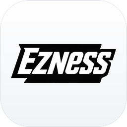
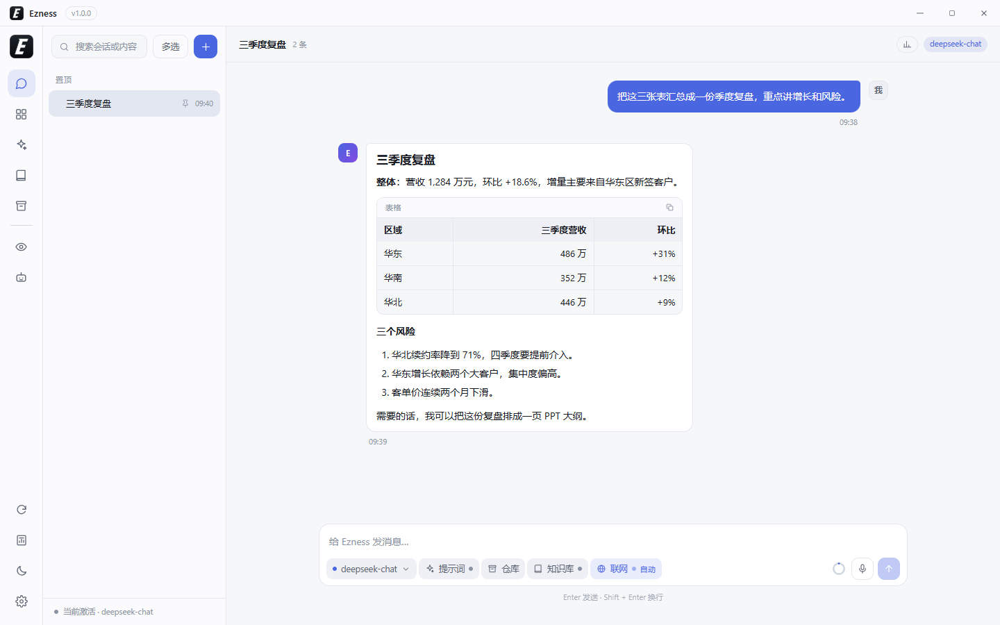
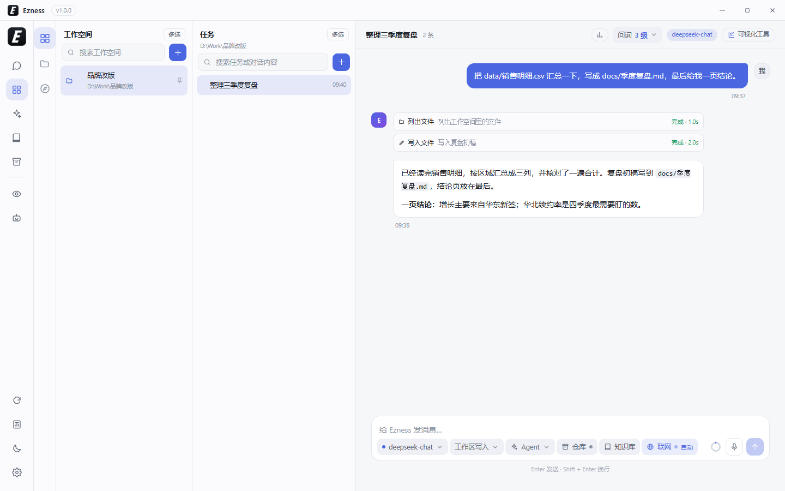
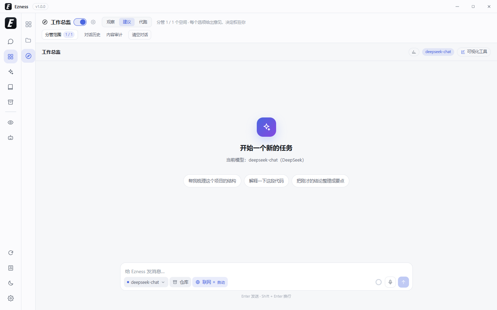
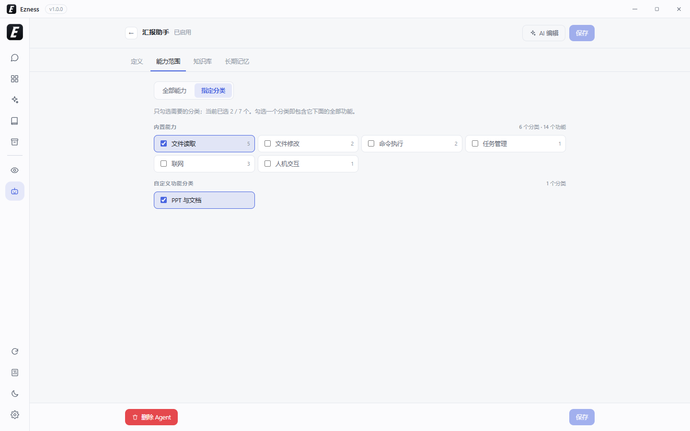
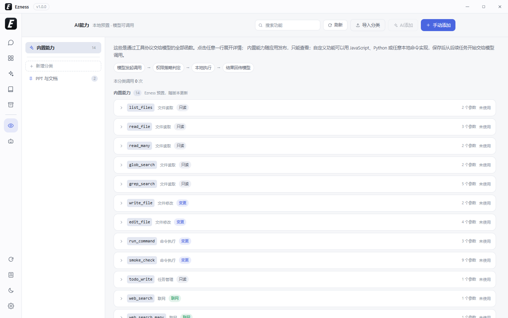
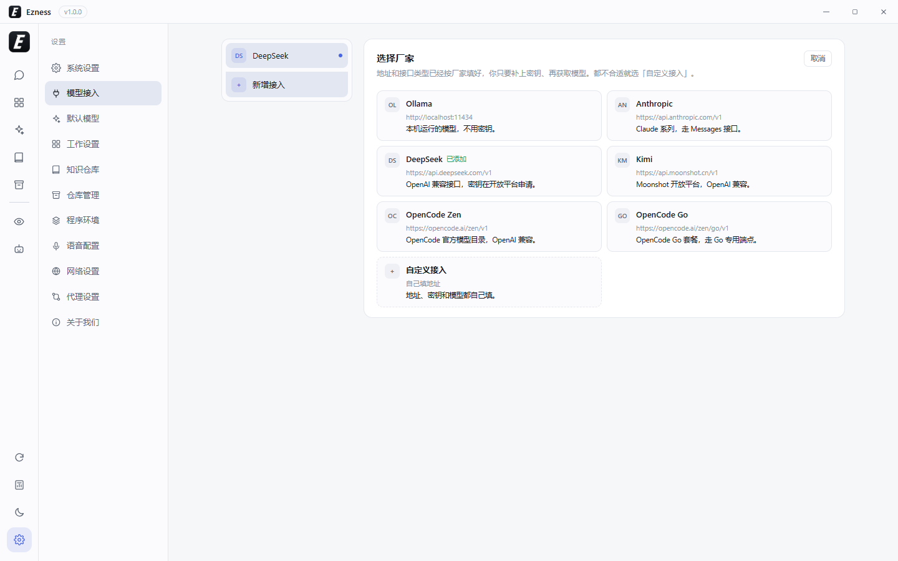
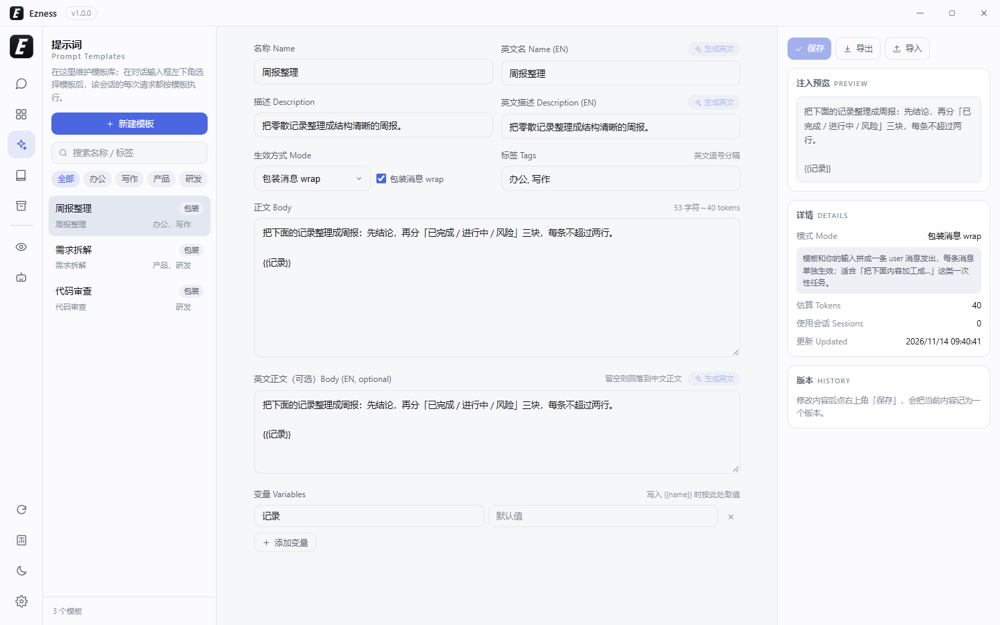
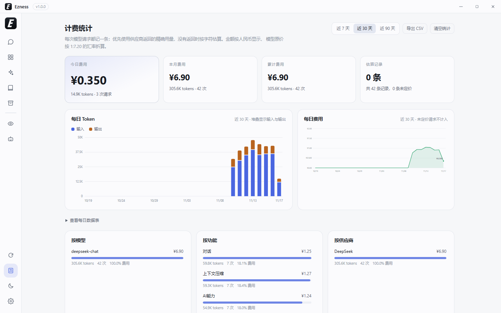
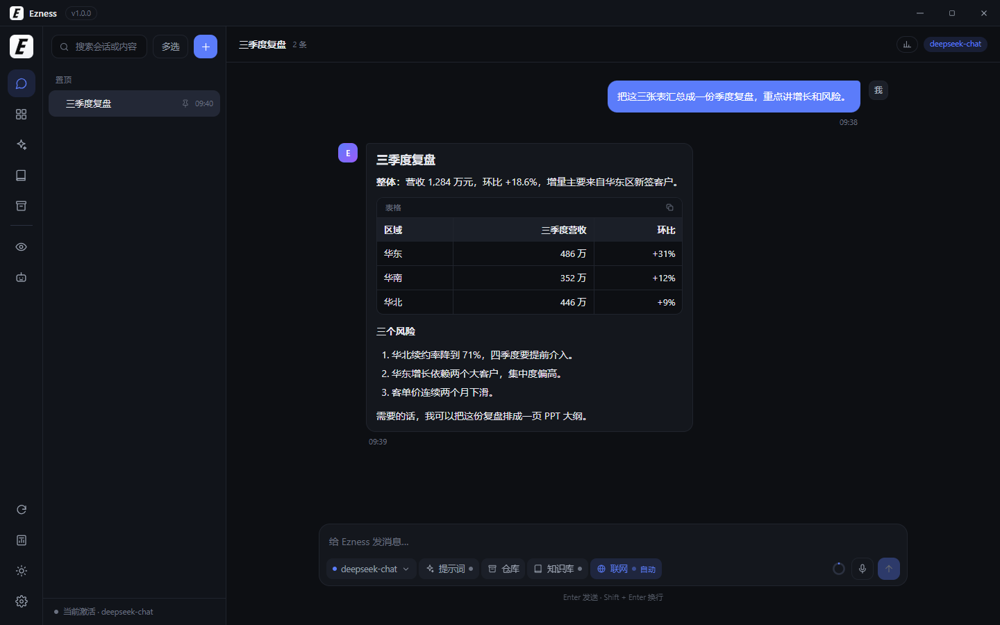

<div align="center">



# EZNess

**Put AI back on your own computer.**

A Windows desktop AI workbench: chat, files, agents, knowledge, tools and a Work Director,
all in one window — with your data kept locally.

<a href="../../releases"></a>


[简体中文](README.md) · **English**



</div>

---

## What it is

Most AI clients stop at a chat transcript. EZNess tries to go one step further:
**let the model actually do the work.**

Point it at a folder and it can read files, edit them and run commands. Give it a goal
and it will break the work into tasks, track progress and write the result back into your
project. You can also build a dedicated agent for recurring work, and let the
"Work Director" keep an eye on things while you are busy elsewhere.

It is not tied to any single model vendor. DeepSeek, Kimi, Claude, local models through
Ollama, or your own OpenAI-compatible gateway — pick one, add a key, and go.

## Why it is different

- **Your data stays on your machine.** Conversations, prompts, knowledge, attachments and
  usage records live in one folder you choose, and you can move the whole folder at any time.
  There is no account system and no cloud sync.
- **It does more than chat.** A workspace is bound to a real local folder. Within the
  permissions you grant, the model reads and writes files and runs commands. Every tool call
  is shown explicitly, with arguments and results available on demand.
- **The same work, on a remote machine.** Add a folder on a server over SSH as a workspace
  and file reads, edits, searches and commands all run there. Credentials stay encrypted on
  this machine, and the host fingerprint is pinned.
- **Someone is watching the shop.** The Work Director monitors running tasks, reports when
  something is stuck, drifting or waiting on your decision, dispatches work to different
  agents, and closes tasks against acceptance criteria.
- **A clean first launch.** No bundled models, no factory prompts, no demo conversations.
  Your workbench starts empty and you add only what you need.
- **Costs you can see.** Input, output, cached tokens and spend are recorded for every request,
  broken down by day, feature and model, and exportable as CSV.

---

## A quick tour

> All screenshots use demo data. No real user content is shown. The interface shown is the
> Chinese UI.

### A chat that handles tables, code and long answers

Markdown tables, syntax highlighting and copy buttons are rendered natively. You can drag or
paste attachments into the composer — PDF, Word, Excel, PowerPoint, Markdown, code and images —
and their content travels with the message, still available to follow-up questions. Sessions
are grouped by Today / Yesterday / This Week / Earlier, and can be pinned or searched.

Below the composer you can switch model, prompt template, warehouse, knowledge base and web
mode at any time. The ring in the corner shows how much context is in use and compacts
automatically before the window is full.

### Workspaces: let the AI work inside your folder

Set a local folder as a workspace and every task gets a real root. The model can list, read,
search, write and edit files, and run commands. Each tool step shows its status, duration and
summary; expand it to see the arguments and the returned result. The task checklist is
updated as work progresses, and the agent reports back when it is done.

Per task you can choose the model, the agent and the question level — from asking before every
file edit to running routine work directly and stopping only for destructive commands.
Remote folders can be added over SSH; see the next section.



### SSH remote workspaces: local interface, remote work

You do not have to copy anything first. In **Workspaces**, choose **+ → Remote SSH address…**,
enter the host, port and user, authenticate with a password or a private key (with an optional
passphrase), then browse the server and pick a folder as the workspace root. It then appears in
the list like any local workspace, with an `SSH` badge on the file tree.

From that point every tool runs on the remote host: list, read, search, write, edit and execute
shell commands. The model sees the real directories on that machine, and commands run against
the remote OS (POSIX syntax on Linux and macOS). The local window is the interface; the files
and the work stay on the server.

A few boundaries are deliberately hard:

- **No path escapes.** Every path is canonicalised on the server and checked against the
  workspace root. A symlink inside the workspace that points at `/etc` cannot reach outside it.
- **Pinned host key.** The server fingerprint is recorded on the first connection; if it ever
  changes, the connection is refused.
- **Credentials stay out of project data.** Passwords and key passphrases are encrypted with
  the OS keystore (DPAPI on Windows) in `remote-secrets.json`; they never enter
  `workspaces.json`, model requests or conversation history.
- **Deletion is permanent.** Local deletes go to the recycle bin; a remote host has none, so
  the UI warns that the delete cannot be undone.

Remote folders have no filesystem watcher, so an open tree is polled periodically and pauses
while the window is hidden.

### Work Director: someone keeps watch while you are away

The Work Director is a resident "manager", not another chatbot. It is off by default and you
decide when to turn it on. Once enabled, you define the projects it looks after; it patrols
them in the background and sends anything worth knowing straight into its own conversation.
It proactively warns about stuck tasks, repeated work or a project drifting off course.

Three levels of authority:

| Mode | What it does |
| --- | --- |
| **Observe** | Points out forks in the road; never decides for you |
| **Advise** | Gives an opinion on every option; the decision stays yours |
| **Run** | Makes routine calls itself; still asks before high-risk operations |

It can also dispatch tasks to suitable agents, track each worker's progress and spend, and
close work against acceptance criteria. Audit records can be drilled down by project, task,
worker and capability. Clearing the conversation archives it first, and the Director's memory
travels with the archive — delete a period and it forgets that period.



### Agents: a specialist for each kind of work

Every agent has its own role, personality, input/output requirements and prompt. Capabilities
are selected by category instead of one tool at a time. An agent can bind knowledge and keep
long-term memory — your preferences and project facts — so the next run picks up where the
last one stopped. Agents can be exported as a package together with their capability
categories and memory, and imported on another machine.



### AI capabilities: write your own tool when the built-ins are not enough

File reading, file editing, command execution, task management, web access and human
interaction ship with the app. When you need more, write a custom capability in JavaScript,
Python or any local command, declare its parameters and permissions, and the model can call it.
Script dependencies are installed into an isolated environment under the data folder, so your
system stays clean.

Every call follows the same path: **model request → permission policy → local execution →
result returned to the model**. Read-only, writable and network access are visible at a glance.



### Model providers: pick one, add a key

Common vendors already have their base URL and API type filled in; one click adds the provider.
Once the key is set, the model list can be fetched in one go. Local providers such as Ollama
need no key. Fully custom OpenAI-compatible endpoints are supported for self-hosted gateways.



### Prompts: keep the wording that works

Templates support variables, Chinese and English bodies, an injection preview and version
history. Select a template and it is applied to every turn of the conversation; the "wrap"
mode appends your input after the template body, which suits one-off transformations.
Templates can be exported to a file and imported again.



### Usage: see where every token went

Today, this month and all-time cost; daily token and cost trends; breakdowns by feature, model
and provider. Input, output, cached tokens, reasoning tokens and generation speed are all
recorded, and the ledger can be exported as CSV.



### Also included

- **Knowledge base**: drop in files to parse, chunk and embed them. PDF, Word, Excel,
  PowerPoint, Markdown, text and code are supported, with file categories, combined categories
  and hybrid BM25 + vector retrieval.
- **Warehouse**: a single home for conversation attachments, deduplicated by content hash,
  with preview, open and copy-reference.
- **Web access**: Off / Auto / Always. In Auto mode the app first decides whether the message
  really needs fresh information, then queries several search engines in parallel and
  validates the results.
- **On-device voice input**: Silero VAD + SenseVoiceSmall run locally; audio never leaves
  the machine.
- **On-device OCR**: PaddleOCR PP-OCRv5 ships with the app and turns images and scanned PDFs
  into text.
- **Interface languages**: Simplified Chinese and English ship with the app and switch in
  Settings. Each language is one JSON file in `locales\` under the data folder, so adding one
  needs no code changes; missing keys fall back to Chinese.
- **Light and dark themes**: two complete palettes, switched instantly.

<div align="center">

<p><sub>Dark mode: the same layout with a second palette, switched instantly.</sub></p>
</div>

---

## Download and install

Get the latest build from [Releases](../../releases). Two options:

| File | Who it is for | How to use |
| --- | --- | --- |
| `EZNess-Setup-<version>.exe` | Most people | Double-click to install for the current user, choose the folder, uninstall included |
| `EZNess-<version>-x64.zip` | Portable use, no install | Extract anywhere and run `EZNess.exe` |

Requirements: **Windows 10 / 11, x64**.

On first launch the app prepares a data folder automatically. To pin it to a specific drive,
open **Settings → System → Storage location**; "Change location" copies and verifies the whole
data set before switching. With the portable build you can also create an `EznessData` folder
next to `EZNess.exe` and the data will travel with the app.

Installed builds start in English. To use another language, open **Settings → System →
Language**; the choice is remembered. Running from source (`npm start`) starts in Chinese.

The first window is empty. Three steps to get going:

1. **Add a model**: **Settings → Model providers**, pick a vendor and enter the key
   (Ollama needs none), fetch the models, then choose one under **Settings → Default models**.
2. **Start chatting**: return to Chat. Prompts, knowledge, warehouse and web access can be
   enabled from the composer whenever you need them.
3. **Let it do work**: add a project folder under **Workspaces** — a local directory, or one
   on a server over SSH — create a task and describe the outcome you want.

> No preinstalled models, prompts or demo conversations is intentional — nothing from the
> factory can leak into your real context.

## Run from source

Node.js 20.19+ or 22.12+, plus npm.

```bash
npm install     # first time
npm run dev     # Vite + Electron with hot reload
npm run build   # type check + build the renderer into dist/
npm start       # run Electron directly (build first)
```

## Build the installer

Windows x64 only. Artifacts are written to `output/`:

```bash
python build.py
```

The script runs a privacy scan, builds the renderer, packages with electron-builder and audits
the result, producing both the installer and the portable zip. electron-builder is installed
into `.packaging-tools/` so the project dependencies stay clean. Useful flags:

```bash
python build.py --skip-build   # dist/ is already current
python build.py --no-clean     # keep old artifacts in output/
python build.py --smoke        # launch once from a clean data folder after packaging
```

## Data and privacy

All application data lives under the storage location you choose:

```
<storage location>\
  settings.json       providers, default models, web entries, recording device
  prompts.json        prompt templates
  usage.json          usage and cost ledger
  chats.json          sessions and messages
  workspaces.json     workspaces and tasks
  agent\              agents, capability categories, custom tools, memory, Director state
  ezrag\              knowledge base (SQLite + original files)
  ezstorge\           warehouse (manifest + attachments)
  voice-models\       on-device voice models
  locales\            language packs (one JSON per language; add your own)
  remote-secrets.json encrypted SSH credentials for remote workspaces
```

A few notes:

- **No cloud account.** The app does not collect or upload your data. Only what you send to a
  model is sent to the model provider you chose.
- **Model keys** are stored locally in `settings.json` and never uploaded. They are currently
  stored in plain text, so do not share the data folder with others.
- **Remote SSH credentials** are encrypted with Electron `safeStorage` (DPAPI on Windows),
  stored separately, and never enter `workspaces.json` or model context.
- **Voice and OCR** run on-device; audio and images do not leave the machine for recognition.
- **Web access** only happens when you enable it. Search queries are sent to the search
  engines enabled in **Settings → Network**.
- **Backup is a folder copy.** Copy the whole storage location to move machines, or use
  "Change location" in Settings.

## Tech stack

Electron 45 · React 19 · TypeScript 7 · Vite 8 (rolldown) · no UI library and no icon library.
The interface is hand-written and themed with a set of CSS variables. The main process owns
model requests, files and commands, agent scheduling, the knowledge base, OCR, voice and SSH;
the renderer talks to it only through APIs exposed via `contextBridge`.

## Project layout

```
electron/            main process
  main.js            window and IPC wiring
  storage.js         data root and full-folder migration
  chat.js            model requests and streaming
  agent/             agent runtime, tools, permissions, Work Director
  kb/                knowledge parsing, chunking, retrieval
  remote/            SSH remote workspaces
  ocr/ voice/        on-device OCR and voice
src/                 renderer (React + TypeScript)
  components/        pages and components
  i18n/              built-in language packs and the translation runtime
  data/              provider presets, prompt and web policy helpers
  styles/            global styles and theme variables
scripts/             development, startup and debugging scripts
build/               application icon
docs/screenshots/    README screenshots
LICENSE              MIT license
THIRD_PARTY_NOTICES.md  third-party component and model notices
build.py             one-shot packaging for Windows x64
```

## License

EZNess is MIT-licensed; see [LICENSE](LICENSE). Notices and attributions for
the third-party components, fonts and models distributed with the app are in
[THIRD_PARTY_NOTICES.md](THIRD_PARTY_NOTICES.md).

## FAQ

**Does it need the internet?**
Cloud models do. With Ollama you can run fully offline — knowledge retrieval, OCR and voice
all run locally.

**Does it support macOS or Linux?**
Only Windows x64 is released and tested today. The codebase is Electron-based and could be
ported, but no adaptation or testing has been done.

**Why is everything empty after installation?**
On purpose. EZNess does not preinstall models, prompts, agents or demo conversations, so
factory content cannot pollute your real context. Add a model and you are ready.

**Can I fork it or use it commercially?**
Yes. The project is MIT-licensed; keep the copyright notice.

**Where is my data, and how do I back it up?**
The full path is shown in Settings. Copying that folder is a complete backup; point the app
back at it on another machine.

---

<div align="center">

Built independently by **EasyBlue**.

Questions and ideas are welcome in [Issues](../../issues).

</div>
