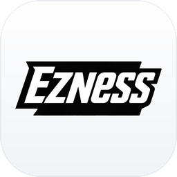
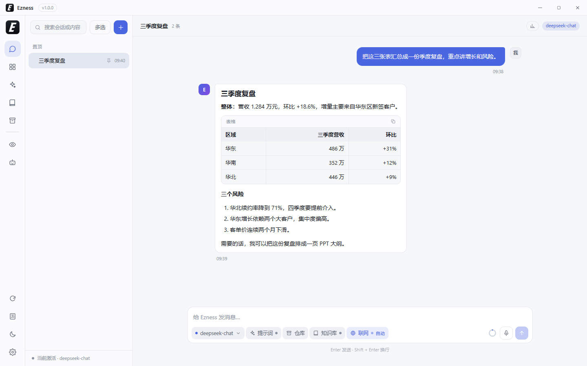
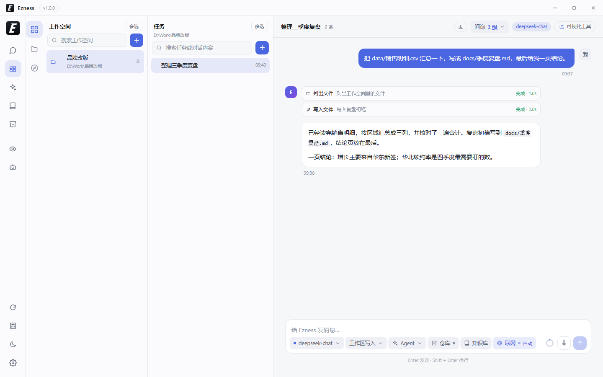
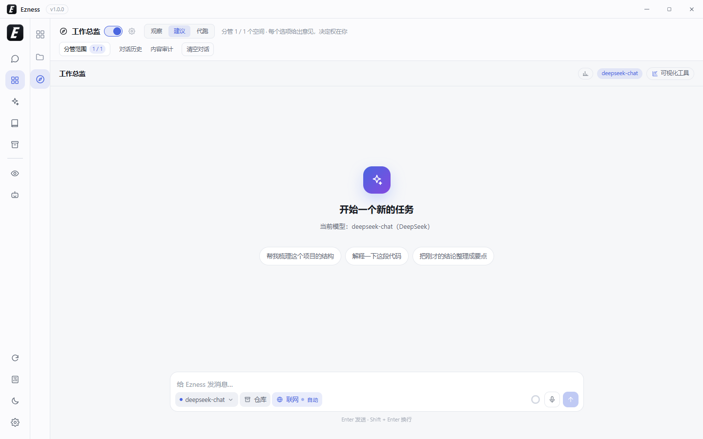
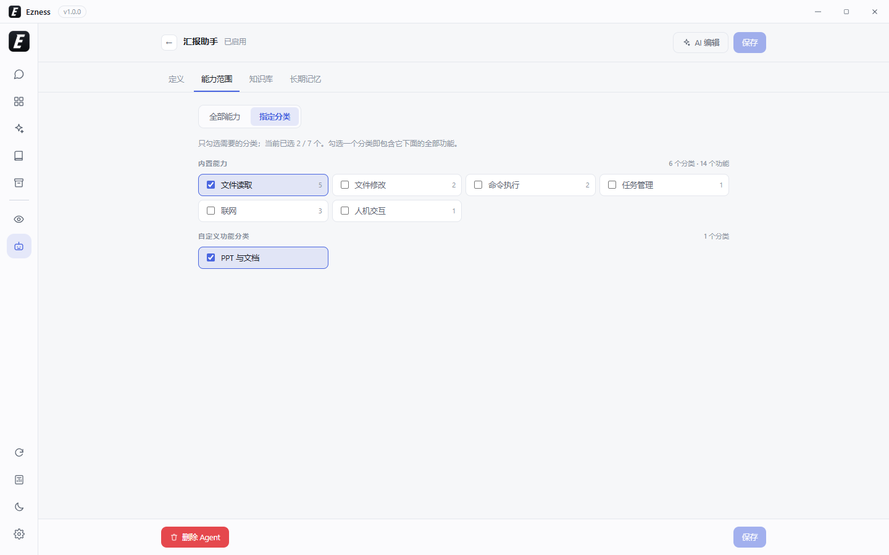
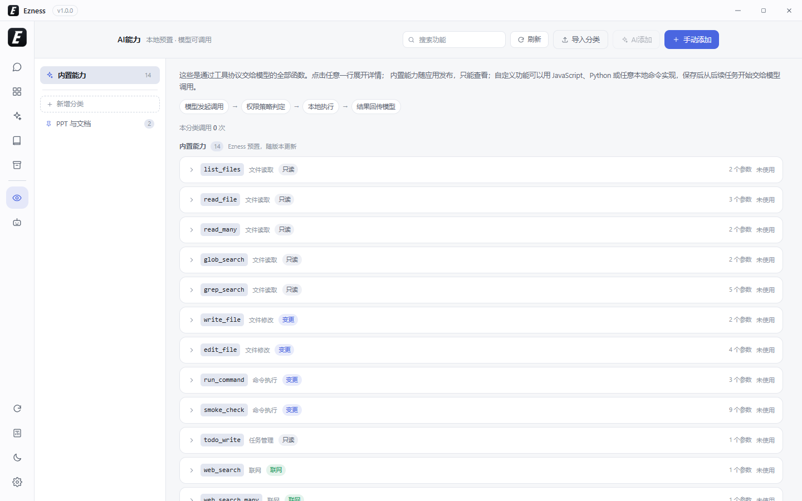
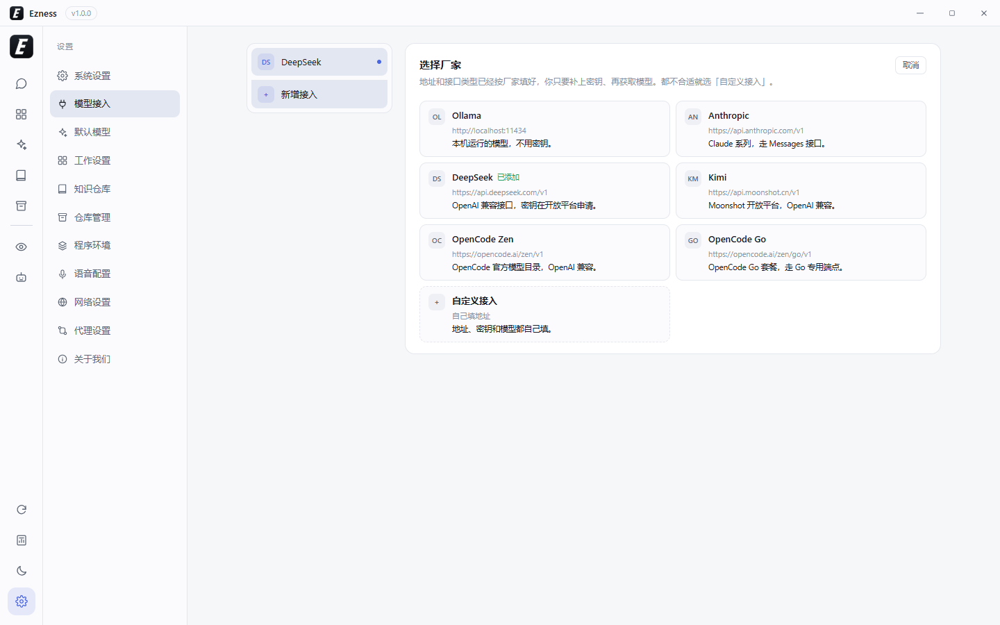
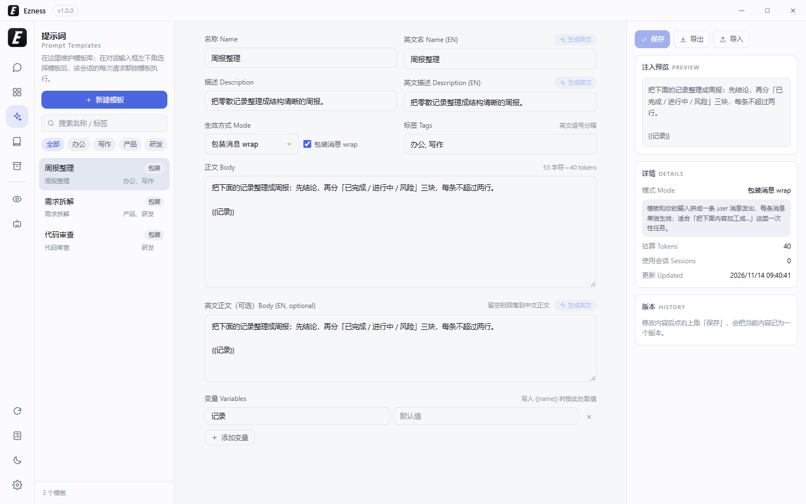
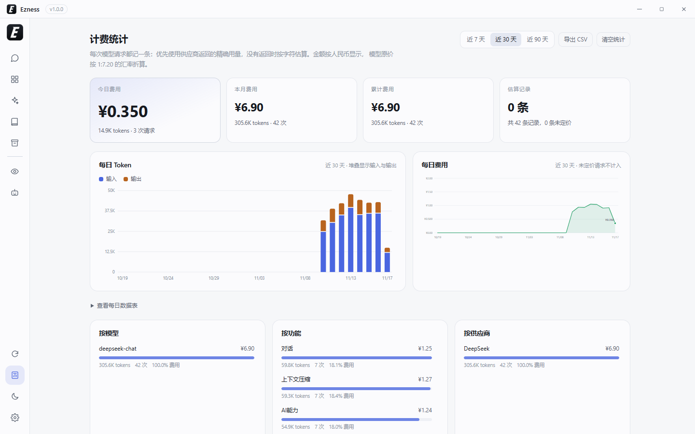
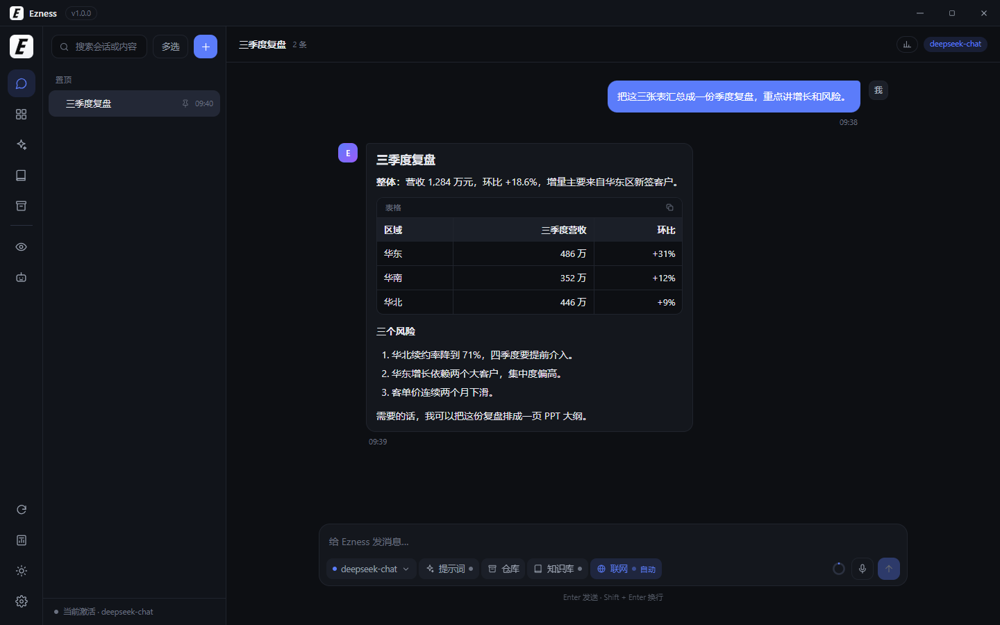

<div align="center">



# EZNess

**把 AI 放回你自己的电脑里。**

一个 Windows 桌面 AI 工作台：对话、文件、Agent、知识库、工具和工作总监，
都在同一个窗口里，数据留在本机。

<a href="../../releases"></a>


**简体中文** · [English](README.en.md)



</div>

---

## 这是什么

市面上大多数 AI 客户端，终点是一段聊天记录。EZNess 想多做一步：**让 AI 真的能动手**。

给它一个文件夹，它会读文件、改文件、跑命令；给它一个目标，它会拆任务、盯进度、
把结果写回你的项目里。你也可以给常做的活配一个专属 Agent，再让「工作总监」
在你忙别的事时帮忙看着。

它不绑定任何一家模型。DeepSeek、Kimi、Claude、Ollama 本机模型，或者你自己的
OpenAI 兼容网关，选一下、填个密钥就能用。

## 为什么值得一试

- **数据在自己手里。** 对话、提示词、知识库、附件、用量账单都存放在你指定的一个目录里，
  随时可以整包搬走；没有账号体系，也没有云端同步。
- **不是只会聊天。** 工作空间直接绑定本地文件夹，AI 在授权的范围内读写文件、执行命令，
  每一步工具调用都摆在明面上，能展开看参数和结果。
- **本机能干的活，服务器上也能干。** 通过 SSH 把远端目录加成工作空间，文件读写、搜索和
  命令都在那台机器上执行；凭据在本机加密保存，主机指纹固定，不跟着配置或对话走。
- **有「人」管事。** 工作总监会盯着在跑的任务，发现卡住、跑偏或需要你拍板时主动汇报，
  还能把活派给不同的 Agent，最后按验收标准收口。
- **装完是干净的。** 不预置模型、不预置提示词、不塞演示对话。你的工作台从空白开始，
  需要什么再加什么。
- **花销看得见。** 每一次请求的输入、输出、缓存和费用都记账，按天、按功能、按模型拆开，
  还能导出 CSV。

---

## 界面巡览

> 下面所有截图都来自演示数据，不含任何真实用户内容。

### 一个对话框，装得下表格、代码和长文

Markdown 表格、代码高亮、复制按钮都是原生渲染。输入框支持拖拽或粘贴附件
（PDF、Word、Excel、PPT、Markdown、代码、图片），内容会跟着这条消息一起交给模型，
之后追问仍然能引用。左侧会话按「今天 / 昨天 / 本周 / 更早」分组，可置顶、可搜索。

输入框下方能随时切换模型、提示词、仓库、知识库和联网方式，右下角的圆环显示
当前上下文用了多少；快到上限时会自动压缩，不会等报错才发现塞不进去。

### 工作空间：让 AI 直接在你的文件夹里干活

把一个本地文件夹设为工作空间，任务就有了根目录。AI 可以列目录、读文件、搜索、
写入和修改、执行命令；每个工具步骤都会显示状态、耗时和摘要，点开能看到参数与返回。
任务清单会跟着执行进度自动勾选，做完再向你汇报。

也可以给任务单独指定模型、Agent 和「问询级别」，决定它多久停下来问你一次：
从每次改文件都确认，到常规操作直接执行、只在破坏性命令前拦一下。
需要连服务器时，也能通过 SSH 添加远程目录作为工作空间，详见下一节。



### SSH 远程工作空间：界面在本机，活在服务器上

不必先把代码拉到本地。在「工作空间」里点 **+ → 远程 SSH 地址…**，填主机、端口和用户名，
用密码或私钥（可带口令）登录，再在服务器上点选一个目录作为根目录——它就和本地工作空间
一样出现在列表里，文件树带一个 `SSH` 标记。

之后所有工具都在远端执行：列目录、读文件、搜索、写入、改写、执行 shell 命令。
模型看到的是那台机器上的真实目录，命令按远端系统执行（Linux / macOS 用 POSIX 语法）。
本机窗口只负责展示和确认，文件和计算都留在服务器上。

几条边界是刻意做硬的：

- **路径不越界。** 每个路径都会先在服务器上解析成真实路径，再检查是否仍在工作空间根目录内；
  根目录里放一个指向 `/etc` 的符号链接也带不出去。
- **主机指纹固定。** 第一次连接会记下服务器指纹，之后指纹不一致就直接拒绝连接，
  避免连到冒充的主机。
- **凭据不进业务数据。** 密码和私钥口令用系统级加密（Windows 下走 DPAPI）保存在
  `remote-secrets.json`，既不进 `workspaces.json`，也不进任何模型请求或会话记录。
- **删除是真删除。** 本地删除会进回收站，远端主机没有回收站，删掉就是删掉，界面会明确提示。

远端目录没有本机那样的文件监听，所以打开的文件树会定时轮询刷新；窗口隐藏时暂停，
不在后台空转。

### 工作总监：你不在时，也有人盯着

工作总监是一个常驻的「管事角色」，不是又一个聊天机器人。默认关闭，由你决定什么时候打开。
开启后，你给它划定分管范围，它会在后台巡视项目、跟踪任务进度，把值得你知道的事
直接发进自己的对话里；发现卡死、重复劳动或方向跑偏时会主动提醒。

三档授权随你切换：

| 模式 | 它会做什么 |
| --- | --- |
| **观察** | 只在关键岔路口提醒，不替你拍板 |
| **建议** | 每个选项给出意见，决定权仍在你 |
| **代跑** | 自己拍板推进；高危操作照样先问你 |

它还能把任务派给合适的 Agent、跟踪每个员工的进度和花费、按验收标准收口；
审计记录可以按项目、任务、员工和能力逐层下钻。清空对话时会先归档，
总监的记忆也跟着存档走——删掉哪段，就忘掉哪段。



### Agent：给每类活配一个专属助手

每个 Agent 有自己的角色、性格、输入输出要求和提示词；能力可以按分类勾选，
不必在一个个工具里挑。它还能绑定知识库、保留长期记忆——记住你的偏好和项目事实，
下次直接接着干。Agent 连同能力分类和记忆可以打包导出，换台电脑导入就能继续用。



### AI 能力：内置工具不够，就自己写一个

文件读取、文件修改、命令执行、任务管理、联网、人机交互，这些内置能力随应用发布。
不够用时，用 JavaScript、Python 或任意本地命令写一个自定义能力，声明参数和权限，
保存后模型就能调用。脚本依赖会自动装进数据目录里的独立环境，不污染系统。

所有调用都走同一条链路：**模型发起 → 权限策略判定 → 本地执行 → 结果回传**。
只读、可写、是否联网一目了然。



### 模型接入：选一家，补个密钥

常见厂家的地址和接口类型已经填好，点一下就能添加；填完密钥可以一键拉取模型列表。
Ollama 这类本机模型不需要密钥。也支持完全自定义的 OpenAI 兼容地址，接自建网关没问题。



### 提示词：把好用的说法存下来

模板库支持变量、中英文双份正文、注入预览和版本历史。选中一个模板，这个会话的
每一轮都会带上它；「包装消息」模式会把你的输入拼在模板后面，适合一次性的整理任务。
模板可以导出成文件分享给别人，也能从文件导入。



### 计费统计：每一个 token 花在哪

今天、本月、累计费用，每日 Token 与费用的趋势，再按功能、模型和厂家拆开。
输入、输出、缓存命中、推理 Token 和生成速度都有记录，账单可以导出 CSV。



### 还有这些

- **知识库**：拖入文件自动解析、切片、向量化，支持 PDF、Word、Excel、PPT、Markdown、
  文本和代码；文件分类与组合分类，BM25 + 向量混合检索。
- **仓库**：对话里的附件集中存放，按内容哈希去重，支持预览、打开、复制引用。
- **联网**：关闭 / 自动 / 总是三档。自动模式下先判断这条消息是否真的需要最新信息，
  多个搜索入口并发抓取并做结果校验。
- **本机语音输入**：Silero VAD + SenseVoiceSmall 在本机推理，音频不上传。
- **本机 OCR**：PaddleOCR PP-OCRv5 随应用分发，图片和扫描版 PDF 都能转成文字。
- **界面语言**：内置简体中文和 English，在设置里一键切换。每种语言就是一个 JSON 文件，
  放进数据目录的 `locales\` 就能新增，不需要改程序；缺少的键会自动回退到中文。
- **明暗主题**：整套界面两套配色，切换即时生效。

<div align="center">

<p><sub>深色模式：同一套布局，两套配色，切换即时生效。</sub></p>
</div>

---

## 下载与安装

到 [Releases](../../releases) 下载最新版本，两种任选：

| 文件 | 适合谁 | 怎么用 |
| --- | --- | --- |
| `EZNess-Setup-<版本>.exe` | 大多数用户 | 双击安装，装到当前用户目录，可自选路径；自带卸载 |
| `EZNess-<版本>-x64.zip` | 想带着走、不想安装 | 解压到任意文件夹，运行 `EZNess.exe` |

系统要求：**Windows 10 / 11，x64**。

首次启动会自动准备一个数据目录。想固定位置或换到别的盘，去
**设置 → 系统设置 → 储存地址**，点「更改位置」会整包复制、校验后再切换。
免安装版还可以在 `EZNess.exe` 旁边建一个 `EznessData` 文件夹，数据就跟着程序走。

安装版首次启动默认使用英文界面；想用中文，去 **设置 → 系统设置 → 语言** 切换，
选择会被记住。从源码运行（`npm start`）时默认中文。

第一次打开时界面是空的。按三步就能开始：

1. **接一个模型**：**设置 → 模型接入** 选厂家、填密钥（Ollama 可跳过），
   拉取模型后到 **设置 → 默认模型** 选上它。
2. **直接对话**：回到「对话」就能用；提示词、知识库、联网都可以在输入框下方按需打开。
3. **让 AI 动手**：在「工作空间」里添加一个项目文件夹——本地目录，或通过 SSH
   连一台服务器上的目录——新建任务，把要求说清楚。

> 不预置模型、提示词和演示对话是故意的——避免出厂内容混进你的真实上下文。

## 从源码运行

需要 Node.js 20.19+ 或 22.12+，以及 npm。

```bash
npm install     # 首次安装依赖
npm run dev     # 开发模式：Vite + Electron，热更新
npm run build   # 类型检查 + 构建前端到 dist/
npm start       # 直接运行 Electron（需要先 build）
```

## 自己打包

只支持 Windows x64，产物统一放进 `output/`：

```bash
python build.py
```

脚本会依次做隐私检查、前端构建、electron-builder 打包和产物审计，
最后得到安装包、免安装压缩包和一份 `EZNess-<版本>-SHA256.txt` 校验文件。
electron-builder 会被装进 `.packaging-tools/`，
不会污染项目依赖。常用参数：

```bash
python build.py --skip-build   # dist/ 已经是最新的，跳过前端构建
python build.py --no-clean     # 保留 output/ 里的旧产物
python build.py --smoke        # 打完后在干净数据目录启动一次，确认能起来
```

## 数据与隐私

所有应用数据都在你选的「储存地址」下，结构大致如下：

```
<储存地址>\
  settings.json      模型接入、默认模型、联网入口、录音设备
  prompts.json       提示词模板
  usage.json         用量与费用账本
  chats.json         会话与消息
  workspaces.json    工作空间与任务
  agent\             Agent、能力分类、自定义工具、长期记忆、工作总监状态
  ezrag\             知识库（SQLite + 原始文件）
  ezstorge\          仓库（清单 + 附件原件）
  voice-models\      本机语音模型
  locales\           语言包（每种语言一个 JSON，可自己添加）
  remote-secrets.json 远程工作空间的 SSH 凭据（系统级加密）
```

几点说明：

- **没有云端账号。** 应用不收集、不上传你的数据；只有你主动发给模型的内容会发给你选择的模型服务商。
- **模型密钥**保存在本机 `settings.json` 中，不会上传；目前是明文存储，请不要把数据目录直接分享给别人。
- **远程 SSH 凭据**使用 Electron `safeStorage`（Windows 下走 DPAPI）加密，单独存放，不进 `workspaces.json`，也不进模型上下文。
- **语音与 OCR**都在本机推理，音频和图片不会因为识别而离开电脑。
- **联网检索**只在你开启时发生，查询词会发给你在「网络设置」里启用的那几个搜索入口。
- **备份就是复制目录。** 换电脑时把整个储存地址拷过去，或在设置里用「更改位置」迁移。

## 技术栈

Electron 45 · React 19 · TypeScript 7 · Vite 8（rolldown）· 无 UI 组件库、无图标库，
界面全部手写，主题走一套 CSS 变量。主进程负责模型请求、文件与命令、Agent 调度、
知识库、OCR、语音和 SSH；渲染进程只通过 `contextBridge` 暴露的接口与主进程通信。

## 目录结构

```
electron/            主进程
  main.js            窗口、IPC 装配
  storage.js         数据根目录、整包迁移
  chat.js            模型请求与流式输出
  agent/             Agent 运行时、工具、权限、工作总监
  kb/                知识库解析、切片、检索
  remote/            SSH 远程工作空间
  ocr/ voice/        本机 OCR 与语音
src/                 渲染进程（React + TypeScript）
  components/        页面与组件
  i18n/              内置语言包与翻译运行时
  data/              厂家预设、提示词与联网策略
  styles/            全局样式与主题变量
scripts/             开发、启动与调试脚本
build/               应用图标
docs/screenshots/    README 截图
LICENSE              MIT 许可
THIRD_PARTY_NOTICES.md  第三方组件与模型许可
build.py             一键打包（Windows x64）
```

## 许可

EZNess 使用 MIT 许可，见 [LICENSE](LICENSE)。随应用分发的第三方组件、字体和模型
许可与归属见 [THIRD_PARTY_NOTICES.md](THIRD_PARTY_NOTICES.md)。

## 常见问题

**需要联网才能用吗？**
调用云端模型需要；用 Ollama 跑本机模型时可以完全离线（知识库检索、OCR、语音也都是本机完成）。

**支持 macOS / Linux 吗？**
目前只发布和验证 Windows x64。源码基于 Electron，理论上可以移植，但没有做适配和测试。

**为什么装完之后什么都没有？**
这是有意为之。EZNess 不预置模型、提示词、Agent 或演示对话，避免出厂内容混进你的真实上下文。
添加一个模型后就能正常使用。

**可以二开或商用吗？**
可以，项目使用 MIT 许可。二次开发时保留版权声明即可。

**数据存在哪？怎么备份？**
在设置里能看到完整的储存地址，整个目录复制走就是完整备份；换电脑后指回这个目录即可。

## 维护日志

### 2026-11-26

- 版本号升到 1.0.1；关于页面新增「更新日志」，列出 1.0.0 之后解决掉的问题。
- 英文覆盖到整个界面。以前只有部分页面有翻译，切到英文后设置、工作总监、任务与工具记录、权限提示、各类报错和系统弹窗里仍有大量中文；现在渲染进程和主进程都走同一套中英语言包，切换语言当场生效，不用重启。
- 主进程产出的界面文案一并支持英文：托盘菜单、关闭询问框、审计事件名、记忆新鲜度标签、知识库 / 远程 / 语音 / Python 等状态与错误。审计记录按稳定的事件码重新取文案，切换语言后旧记录也会跟着变成英文，不会留下一半中文。
- 发给模型的提示词不作翻译；只有最终显示在界面上的模型产物（存档名称、可视化图表标题等）会按界面语言要求输出英文。
- 设置、工作总监等页面里的时间、数量、文件大小改用当前语言的格式规则，英文界面不再出现「1,234 次 · 2026/11/26」这种中文日期写法和中文量词。

### 2026-11-25

- 关闭窗口的行为可以自己定：**设置 → 系统设置** 新增「关闭窗口时」，可选「最小化到托盘」「直接退出程序」或「每次关闭时询问」。第一次点右上角 ✕ 会弹窗问一次，默认「最小化到托盘」，选完就记住；直接关掉弹窗（✕ 或 Esc）则什么都不做，窗口保持打开。最小化到托盘时程序继续在后台运行，正在跑的任务不会中断；双击托盘图标回到主界面，右键菜单里可以退出。弹窗和托盘菜单跟随界面语言（中文 / English）。

### 2026-11-24

- 工作空间列表会检查每个空间是否还能用：本地文件夹不存在、路径不是文件夹，或远程 SSH 主机连不上时，列表项上会出现红色警示标记，打开该空间后任务列表上方会写明原因；应用启动、窗口重新获得焦点和每分钟各检查一次，恢复后标记自动消失。
- 长对话和长任务不再越聊越卡：每条消息单独记忆化，流式输出时只重绘正在写的那一条，已经写完的消息不会跟着反复解析；Markdown 渲染降到低优先级，生成期间输入和滚动保持跟手。历史消息按最近 60 条挂载，往上翻时点顶部「载入更早的 … 条」再逐页载回，不再把几千条消息一次性铺在页面上。会话与任务的搜索索引也只在输入搜索词后才构建。

### 2026-11-20

- 修复任务工作空间的「压缩上下文」：以前只整理页面上的显示记录，模型真正读取的 Agent 历史没有变化。现在会同时折叠该任务的 Agent 会话，下一次请求的上下文真正变短；圆环在下一次请求前先扣除这部分节省。
- Agent 自动压缩改用服务商返回的真实 prompt token 数校准阈值，避免粗略估算偏低、上下文已经接近上限却不触发压缩。
- 重复点「压缩上下文」不会再拿上一份摘要去生成新摘要：已有摘要原样保留，只追加真正的新内容；没有新内容时直接提示，不会改动文件。第一次手动压缩前会留一份 `.jsonl.bak`。
- 压缩后圆环不再停留在压缩前的旧占用：手动压缩会按压缩后的历史预测并记住新的用量，重启后仍然有效；没有记录可参考时改用当前 Agent 历史的实际估算。
- 打包脚本（`build.py`）在产物审计后自动生成 `EZNess-<版本>-SHA256.txt`。

### 2026-11-17

- 1.0.0 首次公开发布：中英文 README、界面语言切换、安装版默认英文、SSH 远程工作空间与第三方许可说明。

---

<div align="center">

由 **EasyBlue** 独立开发。

遇到问题或有想法，欢迎提 [Issue](../../issues)。

</div>
